# Daydeck

**One post a day, together.** Daydeck runs posting challenges for a team, a community or a
class. Everyone gets one prompt a day, turns it into a post in [Buffer](https://buffer.com), and
sees the group's progress on a shared board.

**Try it: [daydeckapp.vercel.app](https://daydeckapp.vercel.app).** Open the demo challenge
under Popular challenges, connect your Buffer account and join: your day 1 is today. The demo's
other members are samples, so you can try the board, the chat and feedback on drafts on your own.
The live app stays up until 8 December 2026.

Daydeck is built for [Buffer Commit](https://buffer.com/api/commit), Buffer's contest for apps
built on the Buffer API. It is built on the Buffer API, and not affiliated with or endorsed by
Buffer.

## How it works

1. **Connect Buffer.** People sign in with Buffer (OAuth). Daydeck never sees a password, and it
   acts only for the person who signed in.
2. **Host or join a challenge.** A host picks the prompts, the dates and the rules, then shares
   an invite link with a team, a community or a class. Active public challenges can also show
   under Popular challenges on the homepage, where anyone can look inside and join.
3. **Post every day.** Each day has one prompt. Participants save it to Buffer as a draft or an
   idea, give it a time from their Buffer schedule, then finish and publish it in Buffer.
4. **Progress checks itself.** Daydeck reads each person's Buffer posts and checks a day off once
   its post is published. A post written straight in Buffer is matched to its day by AI.
5. **Do it together.** A shared board shows everyone's days, and each challenge has its own
   Community. At the end, a recap page gives each person a badge to share.

## Features

- **Prompts for every kind of group:** three starter packs; "Surprise me", which mixes prompts
  from every pack, with Keep, Swap and Shuffle; Buffer's public template library; the prompts
  from Buffer's Creator Camp, credited to Buffer; or your own, with a theme, steps and a draft.
- **Buffer does the posting:** prompts become drafts or ideas in Buffer, tagged with the
  challenge's name. The Schedule page gives each day a free time from the person's Buffer
  posting schedule. Daydeck never publishes anything.
- **AI matching:** a post written straight in Buffer is matched to its day by AI. When the AI is
  sure, the day is checked off; when it is not, Daydeck asks, showing the post's first words and,
  once it is published, links to the post on its network and in Buffer.
- **A real community:** the host's updates, a group chat with replies and reactions, shared posts
  with link cards, and feedback on drafts. Hosts can remove messages, remove or ban people, pause
  joining and make a new invite link.
- **Live:** new messages, reactions and days show within about a second. A bell counts what is
  new in every challenge, and each challenge, or each part of it, can be muted. A notification
  sound is optional, per device.
- **Popular challenges:** with their host's consent, active public challenges show on the
  homepage and on "Your challenges", so anyone can look inside and join. Active means at least
  5 people, at least 10 posts in the last 7 days, and a new post or message in the last 2 days. A private, paused or closed
  challenge is never listed: the database itself refuses it, and visitors see names only for
  people who chose to show them.
- **A finish worth sharing:** a recap page with everyone's days, and a badge for each person.
  A closed challenge counts down to the day its data is deleted.
- **Privacy you can check:** the Your data page shows what Daydeck keeps, who sees it and when it
  is deleted, and lets people download all of it or delete everything. The privacy page lists
  only the services this copy of Daydeck uses.
- **For everyone:** WCAG 2.2 AA (axe checks run in the tests), full keyboard use, light and dark
  themes, and layouts that work from 320px wide phones to wide screens.

## Screenshots

The main flow, from finding Daydeck to the end of a challenge. The people and posts are made up.

<table>
  <tr>
    <td width="50%" valign="top"><b>1. Start page.</b> What Daydeck is, how a challenge works, and what a group gets.</td>
    <td width="50%" valign="top"><b>2. Host a challenge.</b> "Surprise me" mixes prompts from every pack; keep the days you like, shuffle the rest.</td>
  </tr>
  <tr>
    <td width="50%" valign="top">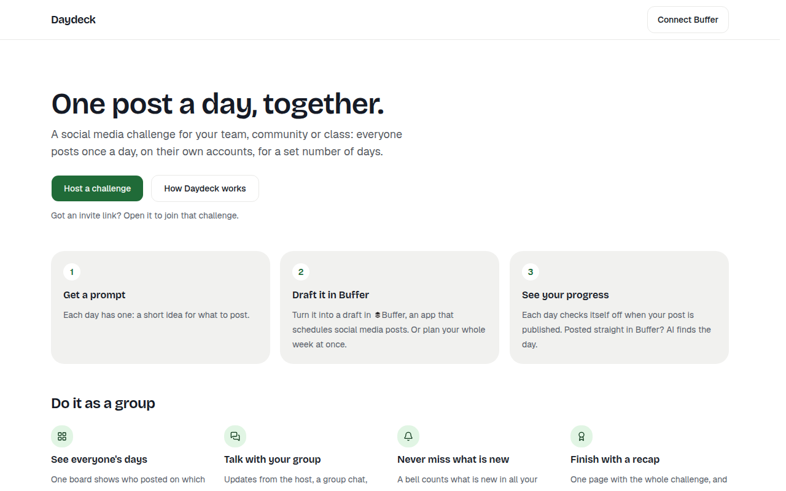</td>
    <td width="50%" valign="top">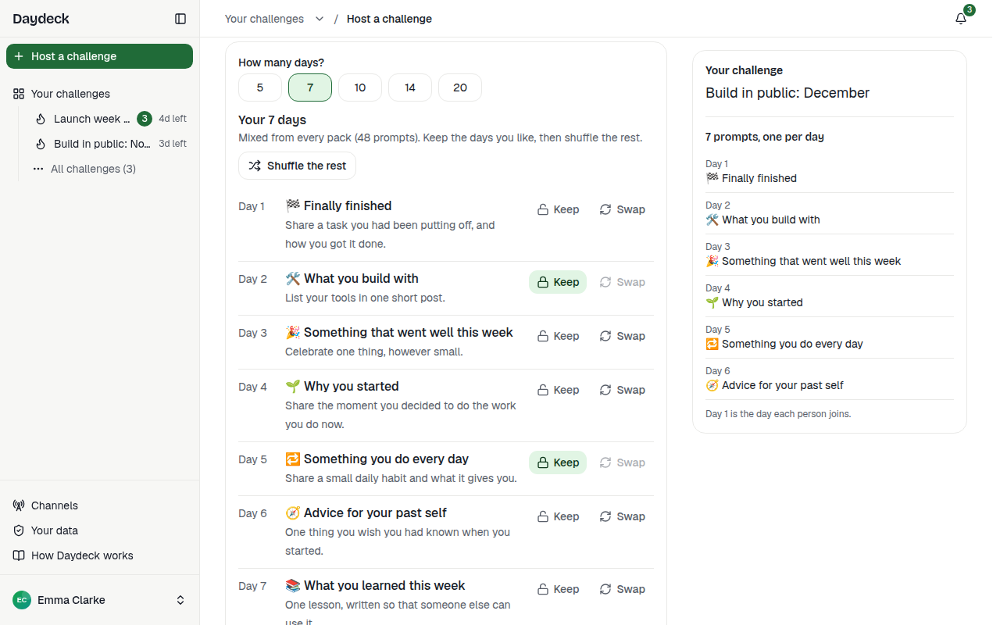</td>
  </tr>
  <tr>
    <td width="50%" valign="top"><b>3. The invite link.</b> What people see before they join: the prompts, who is in, and one button.</td>
    <td width="50%" valign="top"><b>4. Today, with AI.</b> The day's prompt, and the AI asking which day a post written straight in Buffer is for.</td>
  </tr>
  <tr>
    <td width="50%" valign="top">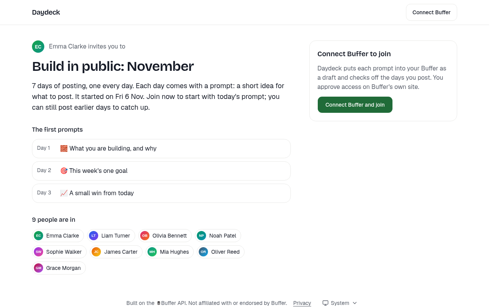</td>
    <td width="50%" valign="top">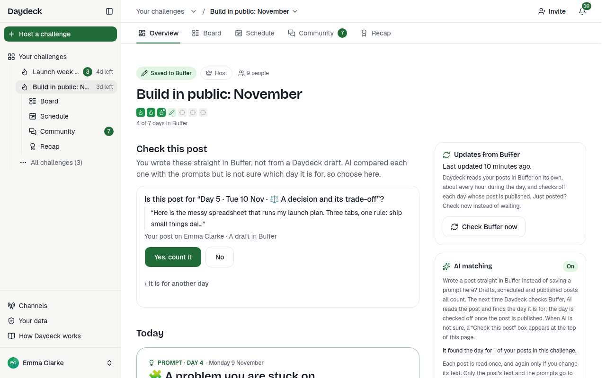</td>
  </tr>
  <tr>
    <td width="50%" valign="top"><b>5. Schedule.</b> Each day gets a free time from your Buffer posting schedule.</td>
    <td width="50%" valign="top"><b>6. Board.</b> Everyone's days side by side: posted, scheduled, saved, caught up or paused.</td>
  </tr>
  <tr>
    <td width="50%" valign="top">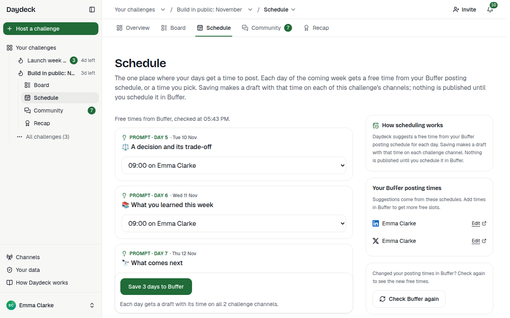</td>
    <td width="50%" valign="top">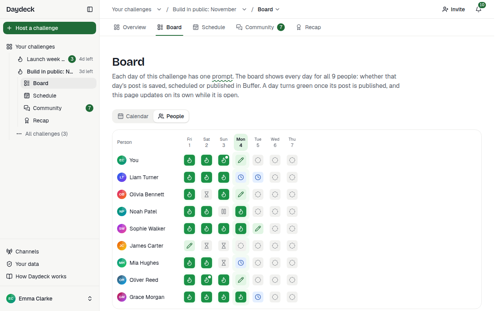</td>
  </tr>
  <tr>
    <td width="50%" valign="top"><b>7. Chat.</b> Replies, reactions, and a "New" line where your unread messages start.</td>
    <td width="50%" valign="top"><b>8. Shared posts.</b> Link cards from X, LinkedIn and Bluesky, with reactions.</td>
  </tr>
  <tr>
    <td width="50%" valign="top">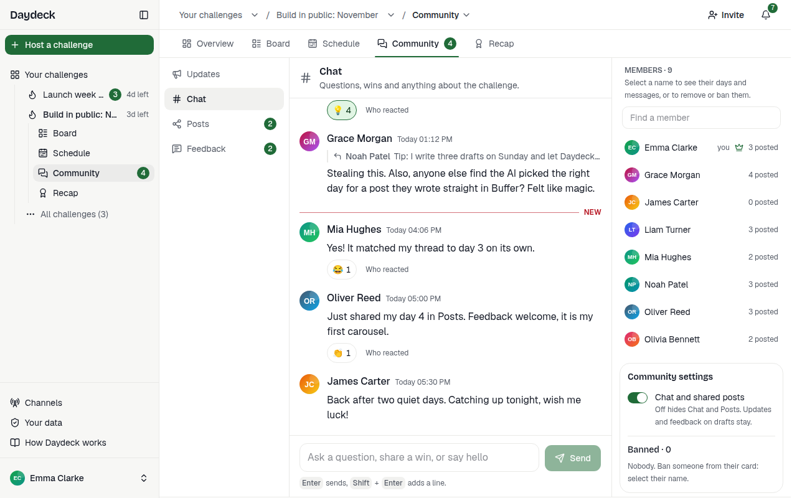</td>
    <td width="50%" valign="top">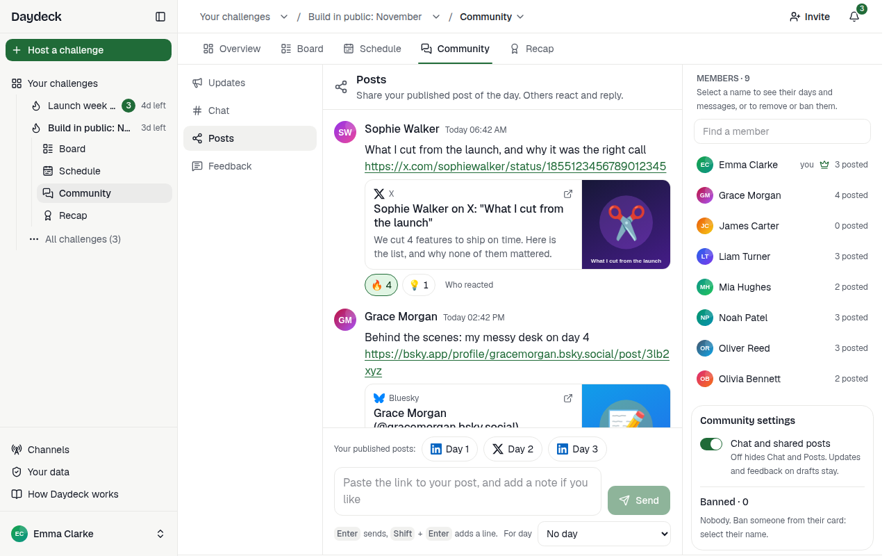</td>
  </tr>
  <tr>
    <td width="50%" valign="top"><b>9. Feedback on drafts.</b> Share a draft with the group and get replies before you post.</td>
    <td width="50%" valign="top"><b>10. Notifications.</b> One bell for every challenge; mute any part of it.</td>
  </tr>
  <tr>
    <td width="50%" valign="top">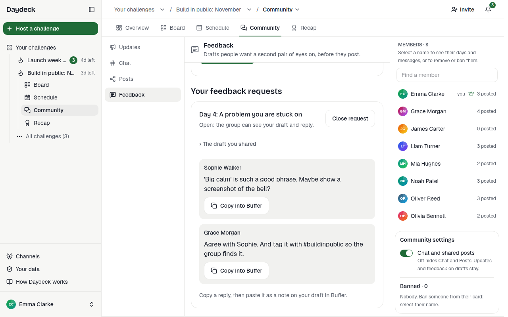</td>
    <td width="50%" valign="top">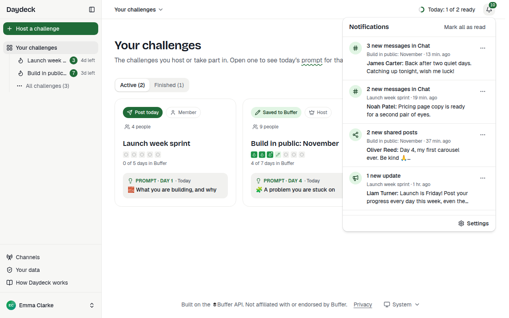</td>
  </tr>
  <tr>
    <td width="50%" valign="top"><b>11. Recap and badge.</b> The whole challenge, and a badge each person can share.</td>
    <td width="50%" valign="top"><b>12. Your data.</b> What Daydeck keeps, who sees it, when it is deleted; download or delete it all.</td>
  </tr>
  <tr>
    <td width="50%" valign="top">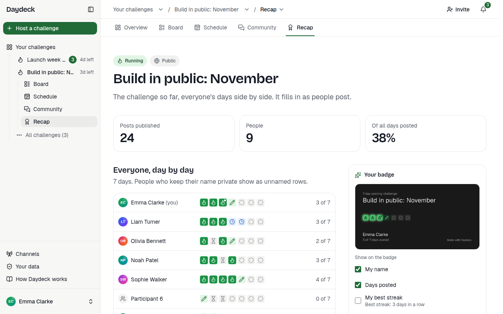</td>
    <td width="50%" valign="top">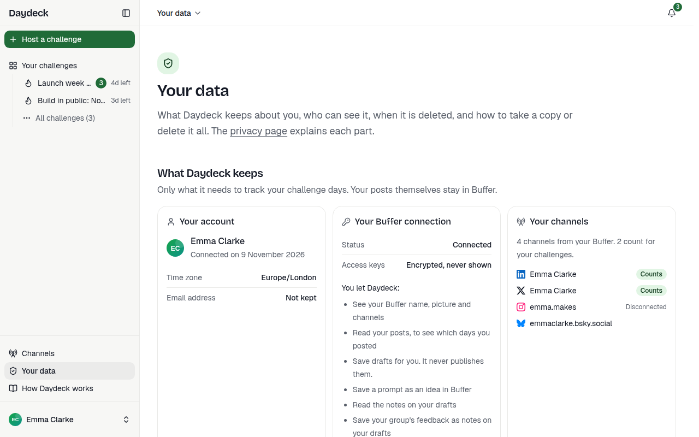</td>
  </tr>
</table>

## Architecture

```text
Browser ──> Next.js 16 on Vercel ──> Neon Postgres (Drizzle ORM)
                 │
                 ├──> Buffer GraphQL API, always with the signed-in person's own token
                 └──> Matcher: TypeSafe Jev or Anthropic Claude (optional)
Inngest (schedules and events) ──> /api/inngest ──> the same server code
```

- **Pages** are React Server Components. They read Postgres and never call Buffer, so opening a
  page uses none of Buffer's rate limit.
- **Server Actions** make every change a person asks for. When one needs Buffer, it calls
  Buffer with that person's token (encrypted in the database), then saves the result.
- **Live updates** use Server-Sent Events: each open tab keeps one stream to `/api/live`. Every
  second the stream asks Postgres one small question (did anything change?) and sends the new
  counts only when the answer changes. It ends after 4 minutes and the browser reconnects, so it
  stays under Vercel's function time limit. Chat, reactions, the board, the sidebar and the
  notification bell react to it; if streams fail, the app asks every 30 seconds instead.
- **Inngest** runs the background jobs. Inngest is a hosted service that calls the app's
  `/api/inngest` route on a schedule or after an event:

  | Job | When | What it does |
  | --- | --- | --- |
  | `challenge-sweep` | Every hour | Queues a check for each participant who is due one |
  | `participant-check` | After the sweep, a join or a save | Reads one person's Buffer posts and updates their days |
  | `day-rollover` | Every 15 minutes | Turns open days whose date has passed into catch-up days |
  | `challenge-close` | Daily, 00:15 UTC | Closes fixed-date challenges after their last day |
  | `data-purge` | Daily, 00:45 UTC | Deletes challenges closed 30 days ago, old sessions, link previews and counters, and clears post previews that are no longer needed |
  | `feedback-write-note` | After a feedback reply | Saves the reply as a Note on the draft in Buffer (only with `FEATURE_BUFFER_NOTES=true`) |
  | `demo-refresh` | Every 30 minutes | Keeps the demo challenge lively as its sample members (only with `DEMO_INVITE_CODE`, until `DEMO_UNTIL`) |

- **The matcher** runs only for posts written outside Daydeck, to find which prompt they
  answer. A post saved from Daydeck is already linked to its day. `MATCHER_PROVIDER` picks it:
  `jev` (TypeSafe's Jev API, the default), `llm` (Anthropic's Claude) or
  `keyword` (word overlap on Daydeck's server, no key). When it is sure, the day is checked off;
  when it is less sure, the person confirms.
- **Sentry** (optional) collects error reports with tokens and personal fields removed.

The code is a [Turborepo](https://turborepo.com) monorepo with pnpm workspaces:

| Path | What it holds |
| --- | --- |
| `apps/web` | The Next.js app: pages, Server Actions, OAuth routes and Inngest jobs |
| `packages/buffer` | Typed client for Buffer's GraphQL API, and the OAuth helpers |
| `packages/db` | Drizzle schema, migrations, starter prompt packs and a test database helper |
| `packages/matcher` | The three matcher providers and the rule that turns scores into a decision |
| `packages/ui` | shadcn/ui components on Base UI, and the design tokens |
| `packages/config` | Shared TypeScript and Biome settings |

## Set up

You need Node.js 26 (pinned in `.node-version`, for fnm or nvm) and pnpm 11:

```bash
npm install --global corepack@latest && corepack enable
pnpm install
cp .env.example apps/web/.env.local   # every setting, with comments
```

The steps below go from what the app cannot run without to what is optional.

### 1. A Buffer app client

In Buffer, open **Settings**, then **API**, and create an app client:

- Leave **Public client** unchecked: the secret stays on the server.
- Redirect URI: `https://localhost:3000/api/auth/buffer/callback` for local use, or
  `https://<your-domain>/api/auth/buffer/callback` for a deployment. It must match exactly.
- Permissions: `account:read`, `posts:read`, `posts:write`, `ideas:read`, `ideas:write`,
  `notes:read`, `notes:write` and `offline_access`. The app cannot work without `account:read`
  and `offline_access`. `ideas:read` only lets Daydeck see when you delete an idea it saved.

Set `BUFFER_CLIENT_ID`, `BUFFER_CLIENT_SECRET` and `BUFFER_REDIRECT_URI`.

### 2. The encryption key

`TOKEN_ENCRYPTION_KEY` encrypts Buffer tokens in the database. Create one with
`openssl rand -base64 32`. Use a different key in production and keep a safe copy: with a new
key, everyone has to connect Buffer again.

### 3. The database (Neon)

Create a [Neon](https://neon.com) project with Postgres 18 in AWS US East 1, near the app's
Vercel region. Set `DATABASE_URL` to the pooled address (its host contains `-pooler`) and
`DATABASE_URL_UNPOOLED` to the direct one. Then create the tables and the starter prompt packs:

```bash
pnpm --filter @daydeck/db db:migrate
```

Any Postgres 18 works locally too, for example with Docker:
`docker run -d -p 5432:5432 -e POSTGRES_USER=daydeck -e POSTGRES_PASSWORD=daydeck -e POSTGRES_DB=daydeck postgres:18`.

### 4. Inngest (background jobs)

Without Inngest, progress updates only when someone presses "Check Buffer now", and nothing
closes or cleans up old challenges.

- **On Vercel:** add the Inngest integration. It sets `INNGEST_EVENT_KEY` and
  `INNGEST_SIGNING_KEY`. After each deploy, choose **Sync with Vercel** in Inngest if the jobs
  do not appear.
- **Locally:** add `INNGEST_DEV=1` to `apps/web/.env.local` and run Inngest's dev server:
  `npx inngest-cli@latest dev -u https://localhost:3000/api/inngest`.

### 5. The matcher

Set `MATCHER_PROVIDER` and its key: `jev` with `JEV_API_KEY`, `llm` with `ANTHROPIC_API_KEY`,
or `keyword` with no key. Without the chosen key, posts written in Buffer wait under "Other
posts", where people give them a day by hand.

### 6. Privacy contact

Set `PRIVACY_CONTACT_NAME` and `PRIVACY_CONTACT_EMAIL`. The privacy page shows them as the
person or team responsible for people's data (the "controller" in the GDPR). The page lists
only the services this copy really uses, from the same settings.

### 7. Sentry (optional)

Set `SENTRY_DSN` (server) and `NEXT_PUBLIC_SENTRY_DSN` (browser). `SENTRY_ORG`,
`SENTRY_PROJECT` and `SENTRY_AUTH_TOKEN` upload source maps at build time. Empty turns Sentry
off.

### 8. Deploy to Vercel

1. Import the repository in Vercel and set **Root Directory** to `apps/web`.
2. Add the Neon and Inngest integrations (and Sentry if you want it), then set the other
   variables from the steps above.
3. Deploy. `apps/web/vercel.json` runs the migrations before every build
   (`pnpm --filter @daydeck/db db:migrate && pnpm --filter @daydeck/web build`) in the region
   `iad1` (Washington, D.C.).
4. Check `https://<your-domain>/api/health`. It answers `{"ok":true,"database":"up"}`.

Do not set `BUFFER_AUTH_URL` or `BUFFER_API_URL` on Vercel: they point local runs at the mock.

**The demo challenge (optional).** A public challenge with sample members, so anyone can join
alone and still see a busy board, chat, shared posts and feedback. The homepage shows it first
under Popular challenges, with a "Demo" label.

1. Create it against the production database: `pnpm --filter @daydeck/db demo:seed`. It prints
   the invite code. Sample members have Buffer IDs that start with `demo-`, so Daydeck never
   calls Buffer for them.
2. Set `DEMO_INVITE_CODE` to that code, and `DEMO_UNTIL` to the last day to show it, then
   redeploy.
3. The `demo-refresh` Inngest job (a scheduled background task) keeps it lively every 30 minutes
   until `DEMO_UNTIL`. Sample members post through the day, start a new round after their 7 days,
   chat, share their posts and ask for and give feedback. It only ever writes as sample members,
   so people who joined keep their own days and messages. Running the seed again does one round
   of the same work at once.
4. To end it, `pnpm --filter @daydeck/db demo:remove` closes it and removes the sample members.

### 9. Local development

You can try every screen without a Buffer account. The repository has a mock Buffer server, a
local stand-in for Buffer's OAuth server and API, with three test accounts. Set these in
`apps/web/.env.local`:

```bash
BUFFER_CLIENT_ID=mock-client
BUFFER_CLIENT_SECRET=mock-secret
BUFFER_AUTH_URL=http://localhost:4010
BUFFER_API_URL=http://localhost:4010/graphql
MATCHER_PROVIDER=keyword
```

Then run, in two terminals:

```bash
pnpm --filter @daydeck/web mock:buffer   # the mock Buffer on http://localhost:4010
pnpm dev                                  # the app on https://localhost:3000
```

The app uses HTTPS locally because Buffer accepts only HTTPS redirect URIs. The first run
creates a local certificate and may ask for your password.

## Tests

```bash
pnpm lint && pnpm typecheck && pnpm test
```

Unit tests use Vitest with PGlite, a Postgres that runs inside the test process, so they need no
database. Set `TEST_DATABASE_URL` to use a real Postgres, as CI does.

End-to-end tests use Playwright with axe accessibility checks, against the mock Buffer server and
a production build on port 3100. Build it in its own folder (`NEXT_DIST_DIR`), so it never clashes
with `pnpm dev`:

```bash
pnpm --filter @daydeck/web exec playwright install chromium   # once
export NEXT_DIST_DIR=.next-e2e BUFFER_REDIRECT_URI=http://localhost:3100/api/auth/buffer/callback
pnpm --filter @daydeck/web build
E2E_MOCK_BUFFER_URL=http://localhost:4010 pnpm --filter @daydeck/web exec playwright test
```

Keep the mock server running. Playwright starts the app on port 3100 by itself.

## Contributing, security and license

- **Contributing:** [CONTRIBUTING.md](CONTRIBUTING.md) covers the checks, the code style and
  what a pull request needs.
- **Security:** report a vulnerability privately, as [SECURITY.md](SECURITY.md) explains. It
  also describes how Daydeck protects tokens and data. CI scans every push for committed
  secrets with [gitleaks](https://github.com/gitleaks/gitleaks).
- **License:** [MIT](LICENSE).
